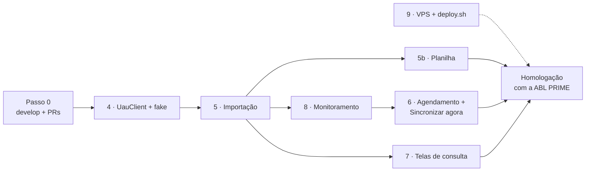

# E1 · Próximos passos — fatias 4 a 9 · 66 h · semanas 2 e 3

Situação em 2026-10-17: as fatias 1 a 3 (30 h de 96 h) estão prontas. Base,
permissões, auditoria e modelo de dados existem, com 130 testes verdes. Faltam
as fatias 4 a 9 e a folga (66 h). A ordem abaixo é: **4 → 5 → 5b → 8 → 6 → 7**,
com a 9 em paralelo assim que houver VPS.

O bloqueio principal é externo. Sem URL HTTPS, usuário técnico e token do UAU
até o fim da semana 2, a E1 é entregue com o `FakeUauClient` e o UAU real é
ligado depois. O código não muda; só o `.env`.

Detalha o [plano da Entrega 1](entrega-1-base-uau-leitura.md). Cada fatia ganha
seu plano detalhado (`entrega-1-fatia-N-*.md`) antes de começar, como as
fatias 1 a 3.

## Onde estamos

| Fatia | Horas | Situação | Branch |
| --- | --- | --- | --- |
| 1 · Setup, limpeza, e-mail, identidade | 12 | Pronta, na `develop`. Falta: e-mail real em homologação (depende do DNS) | `e1/fatia-1-setup` |
| 2 · Perfis, permissões, auditoria | 10 | Pronta, na `develop` | `e1/fatia-2-permissoes` |
| 3 · Migrations e models | 8 | Pronta, na `develop` | `e1/fatia-3-models` |
| 4 · UauClient + fake | 16 | Pronta ([detalhe](entrega-1-fatia-4-uau-client.md)); falta confirmar D4.5 e D4.8 no UAU real | `e1/fatia-4-uau-client` |
| 5 · Importação | 13 | Pronta ([detalhe](entrega-1-fatia-5-importacao.md)) | `e1/fatia-5-importacao` |
| 5b · Carga por planilha | 5 | Pronta ([detalhe](entrega-1-fatia-5b-planilha.md)); falta validar com a planilha real | `e1/fatia-5b-planilha` |
| 6 · Agendamento + "Sincronizar agora" | 5 | Depende da 5 e da 8 | — |
| 7 · Telas de consulta | 8 | Depende da 5 | — |
| 8 · Monitoramento | 6 | Plano pronto ([detalhe](entrega-1-fatia-8-monitoramento.md)) | `e1/fatia-8-monitoramento` |
| 9 · Homologação: VPS + `deploy.sh` | 10 | Independente; espera a VPS | — |
| Folga | 3 | 1 h vai para o passo 0 | — |

## Ordem e dependências

- **8 antes da 6 (decisão):** o botão "Sincronizar agora" fica na tela de
  monitoramento. Com a 8 pronta, a 6 coloca o botão na tela que já existe, em vez
  de criar uma rota provisória.
- **7 por último:** só depende da 5 e é a fatia que melhor absorve atraso. As
  telas podem ser revisadas com a ABL PRIME com dados do fake.
- **9 em paralelo:** começa no dia em que a VPS for entregue, sem esperar o código.

## Cronograma

| Semana | Fatias | Horas |
| --- | --- | --- |
| 2 | Passo 0, 4, 5, início da 5b | 1 + 16 + 13 + 2 = 32 |
| 3 | Fim da 5b, 8, 6, 7, 9 | 3 + 6 + 5 + 8 + 10 = 32 |
| | Folga restante | 2 |
| | **Total** | **66** |

---

## Passo 0 — Arrumar a casa · 1 h (da folga)

Antes da fatia 4, para não acumular branches sem revisão.

**Feito em 2026-10-17**, com uma diferença: sem o GitHub CLI, as fatias foram
juntadas na `develop` por `git merge --no-ff` (o mesmo commit de merge de um PR),
sem PR aberto. Pendente: enviar `develop`, `e1/fatia-1-setup`, `e1/fatia-3-models`
e `e1/fatia-4-uau-client` ao GitHub.

1. Criar `develop` a partir de `main` (D6: `develop` é a homologação) e enviar ao GitHub.
2. Enviar `e1/fatia-1-setup` e `e1/fatia-3-models`. Abrir os PRs das fatias 1,
   2 e 3 contra `develop`, nessa ordem (cada uma parte da anterior).
3. Juntar na `develop` e rodar `vendor/bin/phpunit` nela.
4. Local: `php artisan migrate:fresh --seed`. O mapeamento de nomes polimórficos
   da fatia 3 troca `App\Models\User` por `usuario` no `activity_log`.
5. As próximas branches saem da `develop`: `e1/fatia-4-uau-client` e assim por diante.

## Fatia 4 — UauClient + fake · 16 h · semana 2

Plano detalhado: [entrega-1-fatia-4-uau-client.md](entrega-1-fatia-4-uau-client.md). O Swagger foi lido e responde aos pontos abaixo.

**Entrega:** `app/Integrations/Uau/` com
- a interface `UauGateway` (`empresasAtivas`, `obrasAtivas`, `pessoaPorDocumento`);
- o `UauClient` (HTTP, token em cache, 401 renova uma vez);
- o `FakeUauClient`, que lê `tests/Fixtures/uau/*.json`;
- DTOs em `Data/` e as exceções `UauIndisponivel` e `UauRejeitou`;
- o comando `uau:ping`.

**Já decidido nas fatias 1 a 3, e vale aqui**
- Config em `config/uau.php`. `UAU_FAKE=true` liga o fake no `AppServiceProvider`.
- Uma linha em `integracao_logs` por chamada, com `executado_em` em milissegundos.
  `rota` é relativa à `UAU_BASE_URL` (ex.: `Empresa/ObterEmpresasAtivas`).
- `resposta` é json. Resposta que não é JSON vai como `{"bruto": "..."}`.
  Senha e tokens nunca entram em `payload` nem em `resposta`.
- Estados com os enums `DirecaoIntegracao` e `StatusIntegracao`.

**A fechar no plano detalhado**
- Montar as fixtures a partir dos modelos do Swagger, que é leitura de documentação e não chamada à API.
- Conferir no Swagger se o código da obra é único por empresa e os tamanhos dos
  campos. Se divergir da fatia 3, criar uma migration nova.
- Formato do header `Authorization` (com ou sem "Bearer"): validar com `uau:ping` no primeiro acesso real.

**Pronto quando:** testes com `Http::fake` cobrem
- os dois headers e o token em cache;
- o 401 renovado uma vez;
- o log gravado sem segredos;
- 4xx → `UauRejeitou`, 5xx e timeout → `UauIndisponivel`.

E `uau:ping` roda contra o fake.

## Fatia 5 — Importação de empresas, obras e pessoas · 13 h · semana 2

Plano detalhado: [entrega-1-fatia-5-importacao.md](entrega-1-fatia-5-importacao.md).

**Entrega:**
- os jobs `ImportarEmpresas`, `ImportarObras`, `ImportarPessoa` e `ConciliarPessoas`;
- um mapper por entidade;
- a cadeia `Bus::chain` da conciliação.

**Já decidido, e vale aqui**
- `ativo × deleted_at` (D3.1 da fatia 3): a importação nunca apaga. Busca com
  `withTrashed()`, restaura e atualiza. O que sumiu do UAU vira `ativo = false`.
- Documento já chega normalizado: o DTO `PessoaUau` da fatia 4 limpa e completa
  com zeros (11 ou 14 dígitos conforme o `tipo`).
- Endereço de empresa e obra vem do UAU num texto só: o mapper grava em
  `endereco.logradouro`. O da pessoa vem separado (`PessoaUau::enderecoPrincipal()`).
- O job não envolve a chamada ao UAU em transação, senão o rollback apaga o log da falha.
- Lista vazia do UAU não inativa tudo: zero empresas ou obras ativas é tratado como suspeito.
- Testes de retentativa com `FakeUauClient::falharEm()`.
- Endereço pelo `Endereco::fromArray()`; o cast descarta chaves fora do formato.
- `integracao_logs.entidade` aponta para a empresa, obra ou pessoa, que já estão no mapeamento de nomes polimórficos.

**Pronto quando:**
- importar duas vezes não duplica nada;
- inativa o que sumiu;
- uma obra de empresa desconhecida tem tratamento;
- cada fixture vira os atributos esperados (teste do mapper).

## Fatia 5b — Carga por planilha · 5 h · semanas 2 e 3

Plano detalhado: [entrega-1-fatia-5b-planilha.md](entrega-1-fatia-5b-planilha.md).

**Entrega:**
- tela `Pessoas › Carregar planilha` (`pessoa-importar`);
- o job `ProcessarImportacaoPessoas`;
- o relatório por linha e os vínculos sugeridos.

**Já pronto:**
- o item do menu (`importacao-pessoa.index`) aparece sozinho quando a rota existir;
- a ação de auditoria `planilha-carregada` já está no vocabulário;
- as tabelas `importacoes_pessoas` (com `erro`), `importacao_pessoa_linhas` e `vinculos_sugeridos` existem.

**Novo:**
- `composer require maatwebsite/excel` (D3 do README).
- Rules `Cpf` e `Cnpj` em `app/Rules/`, reaproveitadas na E2. Levar a lógica do
  `validaCPF()` de `helpers.php` para a rule, e o helper passa a chamá-la.

**Pronto quando:**
- cabeçalho inválido é recusado e documento inválido é marcado;
- cada resultado aparece (importada, já existia, não encontrada, inativa);
- recarregar a mesma planilha não duplica nada;
- a linha entra em `PermissoesRotasTest`.

## Fatia 8 — Monitoramento das integrações · 6 h · semana 3

Plano detalhado: [entrega-1-fatia-8-monitoramento.md](entrega-1-fatia-8-monitoramento.md).

**Entrega:**
- lista de `integracao_logs` (`integracao-list`), com filtros por status, operação, direção e período;
- detalhe com payload e resposta formatados;
- "Reprocessar" (`integracao-reenviar`);
- indicador no topo.

**Já pronto:**
- os escopos `falhas()` e `noPeriodo()` do `IntegracaoLog`;
- o lugar reservado no `_navbar.blade.php` para o indicador de falhas;
- o item de menu `integracao.index`;
- o padrão de tela com filtros por `ajaxWithForm`, como na auditoria.

**Pronto quando:**
- os filtros devolvem só as linhas certas;
- reprocessar despacha o job daquela entidade;
- o indicador mostra as falhas das últimas 24 h e a última conciliação bem-sucedida;
- as rotas entram em `PermissoesRotasTest`.

## Fatia 6 — Agendamento + "Sincronizar agora" · 5 h · semana 3

**Entrega:**
- conciliação diária às 05:00 no `app/Console/Kernel.php` (hoje vazio);
- botão "Sincronizar agora" (`integracao-sincronizar`) na tela da fatia 8.

**Já pronto:** a ação de auditoria `sincronizacao-solicitada` está no vocabulário. O botão a registra.

**Pronto quando:**
- o agendamento aparece em `schedule:list`;
- o botão despacha a cadeia;
- um segundo clique com a sincronização em andamento é recusado (`ShouldBeUnique`) com aviso na tela.

## Fatia 7 — Telas de consulta · 8 h · semana 3

**Entrega:** telas só de leitura de pessoas físicas, pessoas jurídicas, empresas
(com as obras) e obras, com filtro ativos/inativos e busca por documento com ou
sem máscara.

**Já pronto:**
- os itens de menu das quatro telas;
- as permissões `pessoa-list`, `empresa-list` e `obra-list`;
- os accessors `cpf_formatado` e `cnpj_formatado`;
- `Endereco::formatado()`;
- os scopes `ativos()` e `inativos()`;
- `Documento::digitos()` para a busca.

**Atenção:** o carregamento sob demanda de relações está barrado fora de
produção. Toda relação mostrada na lista (empresa da obra, PJs sugeridas) precisa de `with()`, senão o teste quebra.

**Pendente da ABL PRIME:** o significado dos códigos de `Status_obr`. Sem ele, a tela mostra o código cru.

**Pronto quando:**
- as quatro listas e os detalhes abrem com dados do fake;
- a busca acha o documento com e sem máscara;
- as rotas entram em `PermissoesRotasTest`.

## Fatia 9 — Homologação: VPS + `deploy.sh` · 10 h · em paralelo

**Entrega:**
- servidor com instalação direta, conforme o plano da E1;
- `deploy.sh` versionado;
- roteiro em `docs/infra/homologacao.md`;
- `HomologacaoSeeder` com um usuário por perfil, adiado na fatia 2 para cá.

**Fecha pendências de outras fatias**
- 1.4: o e-mail real só fica pronto com SPF/DKIM do domínio. Testar a
  recuperação de senha em homologação, conferindo que o e-mail chega à caixa de entrada e não ao spam.
- `UAU_FAKE=false` só com HTTPS e token. Antes disso, a homologação roda com o fake.

## Pendências externas, com prazo

| Item | Bloqueia | Precisa chegar até |
| --- | --- | --- |
| URL HTTPS da UAU API de homologação, usuário técnico (login de até 8 caracteres) e token de integração | Ligar o UAU real | Fim da semana 2 |
| VPS de homologação + acesso root | Fatia 9 | Início da semana 3 |
| Domínio do sistema e do remetente (SPF/DKIM) | E-mail real (1.4) e HTTPS (fatia 9) | Início da semana 3 |
| Planilha de CPFs/CNPJs dos prestadores | Validar a 5b com dados reais | Semana 3 |
| Significado de `Status_obr` | Rótulo na fatia 7 | Semana 3 |
| Logo e cor principal | Identidade visual (hoje: nome em texto e cor padrão) | Antes da homologação |
| Validação dos perfis iniciais (seção 6 da especificação) | Ajuste do `PerfilSeeder` | Antes da homologação |

Cobrar as três primeiras na reunião desta semana. Elas definem se a E1 é
homologada com o UAU real ou com o fake.

## Critério de aceite da E1 × fatias

| Critério (plano da E1) | Fatias |
| --- | --- |
| 1. Cada usuário vê só o menu das suas permissões; perfil novo funciona sem código | 2 (pronto), 9 (usuários de teste) |
| 2. Empresas e obras ativas batem com o UAU de homologação | 4, 5, 6 + UAU real |
| 3. Planilha carregada, com relatório por linha | 5b + planilha real |
| 4. Pessoa alterada no UAU aparece alterada no dia seguinte ou com "Sincronizar agora" | 5, 6 |
| 5. Falha simulada aparece no monitoramento e se resolve na próxima tentativa | 4 (exceções), 5 (retentativa), 8 |
| 6. Recuperação de senha por e-mail funciona | 1 (pronto) + 9 (DNS) |

## Como trabalhar cada fatia

O mesmo processo das fatias 1 a 3:
1. Plano detalhado `entrega-1-fatia-N-*.md` (tarefas com horas, decisões, testes,
   "pronto quando", riscos), revisado antes do código.
2. Branch a partir da `develop`, um commit por tarefa, com os testes no mesmo commit.
3. Rotas novas entram no `PermissoesRotasTest`; itens de menu já estão em `config/menu.php`.
4. Antes do PR: `vendor/bin/phpunit` e `migrate:fresh --seed` duas vezes (SQLite e MySQL de um banco temporário).
5. Atualizar a especificação técnica (backlog da E1) quando a fatia fechar.
